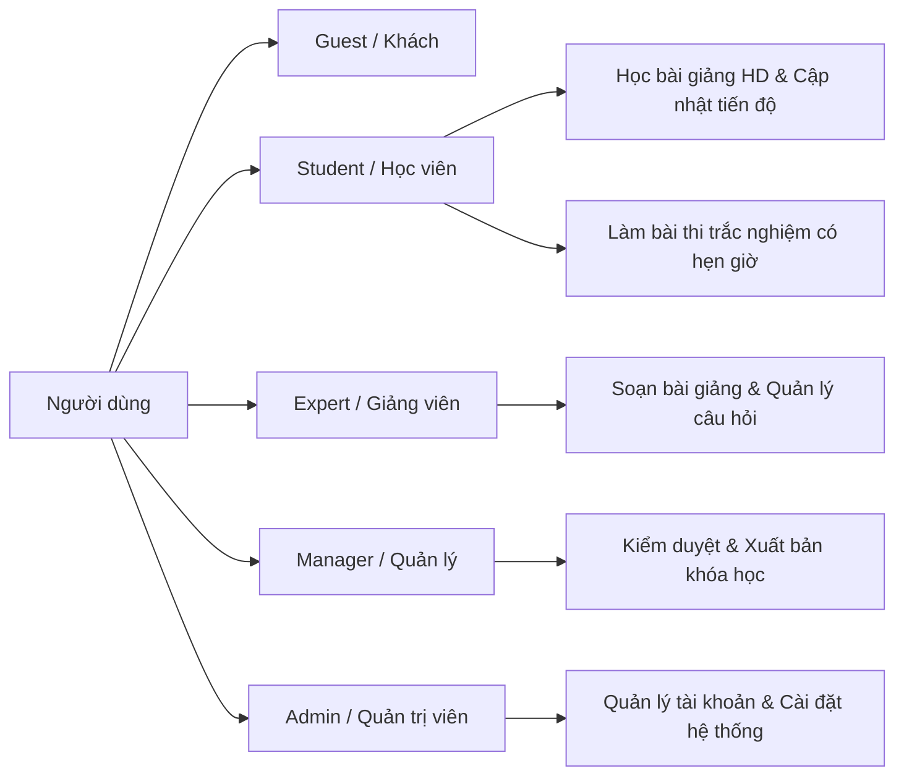

# 🎓 Courson LMS - Nền Tảng Quản Lý Học & Đánh Giá Trực Tuyến

<div align="center">

[](https://openjdk.org/)
[-red.svg)](https://jakarta.ee/)
[](https://www.postgresql.org/)
[](https://tomcat.apache.org/)
[](https://getbootstrap.com/)
[](#)

**Dự án Thực hành Phát triển Phần mềm (SWP391) • Lớp SE2051-NET • Nhóm 5 • Đại Học FPT**

[🚀 Chạy Trực Tiếp Trên Trình Duyệt](#-cách-1-chạy-trực-tiếp-trên-trình-duyệt-khuyên-dùng-khi-chấm-thử) • [Tính Năng Chi Tiết](#-2-tính-năng-chi-tiết-theo-phân-quyền) • [Kiến Trúc & Bảo Mật](#-3-kiến-trúc-hệ-thống--an-toàn-bảo-mật) • [Cơ Sở Dữ Liệu (14 Bảng)](#-4-cơ-sở-dữ-liệu-postgresql-14-bảng) • [Cài Đặt Backend Tomcat](#-cách-2-triển-khai-đầy-đủ-trên-tomcat-10--postgresql) • [Tài Khoản Test](#-7-tài-khoản-thử-nghiệm-mặc-định)

</div>

---

## ⚡ 1. Giới thiệu dự án

**Courson LMS** là giải pháp nền tảng học tập trực tuyến (Learning Management System) toàn diện, được thiết kế theo kiến trúc chuẩn doanh nghiệp **Layered Architecture (MVC + Service Layer + DAO Pattern + Security Filters)** trên nền tảng **Jakarta EE 10 (Servlet 6.0, JSP 3.1, JSTL 3.0)** và cơ sở dữ liệu quan hệ **PostgreSQL 14+**.

Hệ thống quản lý chu trình học tập khép kín từ khám phá khóa học, xem bài giảng video đa phương tiện độ phân giải cao, theo dõi tiến độ học tập theo thời gian thực, làm bài thi trắc nghiệm tính điểm đếm ngược (Quiz Engine) đến quản lý người dùng và cấu hình tham số hệ thống theo mô hình phân quyền 4 vai trò (**RBAC**).

---

## 🌐 Trải nghiệm Trực tiếp: 2 Cách chạy dự án

Dự án hỗ trợ **2 phương thức khởi chạy** linh hoạt:

### 🌟 Cách 1: Chạy trực tiếp trên GitHub Pages & Trình duyệt (Khuyên dùng khi chấm thử)

> [!TIP]
> **Không yêu cầu cài đặt Apache Tomcat, Maven hay PostgreSQL!** Toàn bộ giao diện, dữ liệu 3 khóa học thực tế, 118 bài giảng YouTube chuẩn HD, 12 bộ đề thi trắc nghiệm và chức năng đổi vai trò (Student / Expert / Manager / Admin) đã được đóng gói thành **1 file duy nhất [`index.html`](file:///d:/LMHT/SWP/SE2051-NET_SWP391_G5/index.html)** tương thích 100% với **GitHub Pages**.

#### 1. Chạy trên GitHub Pages (Live trên Internet):
Chỉ cần 3 bước kích hoạt trên GitHub Repository:
1. Vào tab **Settings** của repository trên GitHub ➔ Chọn menu **Pages** (cột bên trái).
2. Tại mục **Build and deployment** ➔ **Source**: Chọn **Deploy from a branch**.
3. Chọn Branch: **`main`**, thư mục: **`/ (root)`** ➔ Nhấn **Save**.
4. Sau 30–60 giây, trang web sẽ chạy trực tiếp tại địa chỉ:
   ```text
   https://<username>.github.io/SE2051-NET_SWP391_G5/
   ```

#### 2. Mở trực tiếp trên máy tính cá nhân (Offline / Local):
* Nhấp đúp chuột vào file [`index.html`](file:///d:/LMHT/SWP/SE2051-NET_SWP391_G5/index.html) bằng bất kỳ trình duyệt web nào (Google Chrome, Microsoft Edge, Mozilla Firefox).
* Mọi tính năng (video YouTube, tính điểm trắc nghiệm, chuyển vai trò) hoạt động mượt mà ngay lập tức.

---

### ☕ Cách 2: Triển khai đầy đủ trên Tomcat 10 + PostgreSQL

Dành cho việc kiểm thử toàn diện tầng Backend Servlets, Database Persistence và Filters:

#### Yêu cầu môi trường:
* **Java Development Kit (JDK):** Phiên bản **17 LTS** hoặc **21 LTS** (Khuyến nghị OpenJDK 17/21).
* **Apache Maven:** Phiên bản **3.8+**.
* **Apache Tomcat:** Phiên bản **10.1+** (hỗ trợ đặc tả Jakarta Servlet 6.0).
* **PostgreSQL:** Phiên bản **14+** (cổng mặc định `5432`).

#### Các bước thiết lập:

##### Bước 1: Khởi tạo Cơ sở dữ liệu PostgreSQL
Mở terminal hoặc pgAdmin và thực thi tuần tự 2 file SQL:
```bash
# Tạo CSDL
createdb -U postgres courson_db

# Nạp cấu trúc 14 bảng chuẩn hóa
psql -U postgres -d courson_db -f database/schema.sql

# Nạp dữ liệu mẫu hợp nhất (3 khóa học, 118 bài giảng, 12 đề thi)
psql -U postgres -d courson_db -f database/seed.sql
```

##### Bước 2: Cấu hình thông số kết nối
Kiểm tra file cấu hình [`src/main/resources/db.properties`](file:///d:/LMHT/SWP/SE2051-NET_SWP391_G5/src/main/resources/db.properties):
```properties
db.url=jdbc:postgresql://localhost:5432/courson_db
db.user=postgres
db.password=sa
```

*(Tùy chọn cấu hình SMTP gửi email kích hoạt tài khoản trong [`src/main/resources/mail.properties`](file:///d:/LMHT/SWP/SE2051-NET_SWP391_G5/src/main/resources/mail.properties)).*

##### Bước 3: Biên dịch & Đóng gói WAR
```bash
mvn clean package -DskipTests
```
*File `Courson.war` sẽ được tạo tại thư mục `target/Courson.war`.*

##### Bước 4: Deploy lên Tomcat 10
1. Copy file `target/Courson.war` vào thư mục `webapps/` của Apache Tomcat 10.1+.
2. Khởi động Tomcat:
   ```bash
   # Trên Windows
   catalina.bat run
   # Trên Linux/macOS
   ./catalina.sh run
   ```
3. Truy cập hệ thống tại: **[http://localhost:8080/Courson/](http://localhost:8080/Courson/)**
   *(Có thể truy cập trực tiếp bản demo tương tác tại: [http://localhost:8080/Courson/demo.html](http://localhost:8080/Courson/demo.html)).*

---

## 🌟 2. Tính năng chi tiết theo phân quyền



### 👨‍🎓 1. Dành cho Học viên (Student - `student1`)
* **Khám phá Khóa học (Course Catalog):**
  * Tìm kiếm theo từ khóa thông minh, lọc khóa học theo danh mục (Nhân tướng học, Tử Vi & Phong Thủy, Chiêm Tinh & Hoàng Đạo, Lập trình Web...).
  * Xem thông tin chi tiết khóa học, tiểu sử giảng viên, giá học phí và đề cương chương mục (Syllabus).
* **Không gian Học tập Tương tác (Learning Workspace):**
  * Tự động phát video bài giảng chất lượng cao (tích hợp YouTube Embed và Auto-Thumbnail).
  * Danh mục đề cương bài giảng có phân chia chương (Module), tích hợp ô tìm kiếm bài học nhanh.
  * Nút bấm **"Đánh dấu hoàn thành"**: Tự động ghi nhận bài học đã học (`lesson_progress`) và cập nhật thanh tiến độ % của khóa học tức thời.
  * Điều hướng mượt mà bài trước / bài tiếp theo.
* **Động cơ Kiểm tra & Đánh giá (Live Quiz Engine):**
  * Đồng hồ đếm ngược thời gian thực (15 phút đếm lùi, cảnh báo chuyển đỏ khi còn dưới 2 phút).
  * Hiển thị danh sách câu hỏi trắc nghiệm kèm trạng thái đã chọn/chưa chọn (Pills indicator).
  * Tự động chấm điểm, tính tổng điểm đạt/không đạt dựa theo điểm chuẩn (`pass_score = 75/100`).
  * Xem lại bài thi chi tiết: Tô màu trực quan đáp án đúng (xanh) / đáp án sai (đỏ) kèm lời giải thích.
* **Đăng ký Khóa học & Hồ sơ:**
  * Đăng ký khóa học, cập nhật thông tin cá nhân, đổi mật khẩu tài khoản.

### 👨‍🏫 2. Dành cho Chuyên gia / Giảng viên (Expert - `expert1`)
* **Bảng điều khiển Giảng viên (Expert Dashboard):** Thống kê tổng số khóa học được giao phụ trách, tổng bài giảng và số lượng đề thi.
* **Quản lý Chương học (Modules) & Bài giảng (Lessons):**
  * Thêm mới, chỉnh sửa và sắp xếp thứ tự các chương học và bài giảng.
  * Nhúng video bài giảng qua URL YouTube hoặc YouTube Video ID, soạn thảo tóm tắt nội dung bài học.
* **Ngân hàng Câu hỏi (Question Bank):** Quản lý tập trung các câu hỏi trắc nghiệm đơn, trắc nghiệm nhiều đáp án cho từng Module; phân loại theo mức điểm.
* **Thiết lập Đề thi (Quiz Administration):**
  * Cấu hình đề kiểm tra theo chương, thiết lập thời gian làm bài (`time_limit_minutes`), điểm sàn qua môn (`pass_score`).
  * Gán câu hỏi từ ngân hàng câu hỏi vào bài thi (`assign-question`) có kiểm tra chống trùng lặp dữ liệu và xác thực điểm hợp lệ.

### 👔 3. Dành cho Quản lý Khóa học (Manager - `manager1`)
* **Bảng điều khiển Quản lý (Manager Dashboard):** Theo dõi số lượng học viên, số lượt làm bài thi, tổng doanh thu và tỷ lệ đỗ quiz.
* **Kiểm duyệt & Chuyển trạng thái Khóa học:**
  * Phê duyệt khóa học giữa các trạng thái `DRAFT` (Bản nháp), `PUBLISHED` (Đã xuất bản) và `ARCHIVED` (Lưu trữ).
  * Phân công chuyên gia (Assign Expert) phụ trách nội dung chuyên môn cho từng khóa học.
* **Quản lý Đăng ký:** Theo dõi danh sách đăng ký học viên và cập nhật trạng thái truy cập.

### 👑 4. Dành cho Quản trị viên Hệ thống (System Admin - `admin`)
* **Quản lý Người dùng (User Management):**
  * Xem danh sách toàn bộ người dùng, tìm kiếm theo tên hoặc email, lọc theo vai trò (`STUDENT`, `EXPERT`, `MANAGER`, `ADMIN`).
  * Khóa hoặc kích hoạt lại tài khoản người dùng (`ACTIVE` / `BANNED`).
* **Cài đặt Hệ thống (Settings Management):** Quản lý động các danh mục khóa học (`COURSE_CATEGORY`) và nhóm vai trò người dùng (`USER_ROLE`), cấu hình độ ưu tiên hiển thị (`priority`).

---

## 🏗️ 3. Kiến trúc Hệ thống & An toàn Bảo mật

### Mô hình Phân Tầng Chuẩn (Layered Enterprise Architecture):

```
+-------------------------------------------------------------+
|                 Trình Duyệt (Web Browser)                   |
+------------------------------+------------------------------+
                               | HTTP / HTTPS Requests
                               v
+-------------------------------------------------------------+
|                 Security & Filter Layer                     |
|  - EncodingFilter: Ép chuẩn mã hóa ký tự UTF-8              |
|  - AuthenticationFilter: Kiểm tra đăng nhập (Public/Private)|
|  - AuthorizationFilter: Phân quyền theo vai trò (RBAC)      |
+------------------------------+------------------------------+
                               |
                               v
+-------------------------------------------------------------+
|               Controller Layer (Jakarta Servlets)           |
|  - AuthServlet, CourseServlet, LessonServlet, QuizServlet   |
|  - AdminCourseServlet, ManagerDashboardServlet, UserServlet |
+------------------------------+------------------------------+
                               |
                               v
+-------------------------------------------------------------+
|                 Service Layer (Business Logic)              |
|  - AuthService, CourseService, QuizService, UserService     |
|  - Kiểm tra điều kiện nghiệp vụ, mã hóa, tính toán điểm số  |
+------------------------------+------------------------------+
                               |
                               v
+-------------------------------------------------------------+
|            Data Access Objects (DAO Layer - JDBC)           |
|  - CourseDao, LessonDao, QuizDao, UserDao, SettingDao...    |
|  - 100% PreparedStatements (Chống SQL Injection)            |
+------------------------------+------------------------------+
                               |
                               v
+-------------------------------------------------------------+
|                 PostgreSQL 14+ Relational DB                |
+-------------------------------------------------------------+
```

### Cơ chế Bảo Mật & Đảm Bảo Chất Lượng (QA):
1. **Mã hóa Mật khẩu:** Ứng dụng thuật toán **BCrypt** độ dài salt rounds 12 thông qua thư viện `org.mindrot.jbcrypt`.
2. **Xác thực Đăng ký qua Email Token:** Tạo chuỗi token ngẫu nhiên có thời hạn lưu trong bảng `email_verification_tokens` gửi qua Jakarta Mail (Angus Mail).
3. **Phòng chống Lỗ hổng Cấp Dữ liệu (IDOR Prevention):** Kiểm tra ràng buộc sở hữu `registration.getUserId() == session.getUserId()` ở controller layer trước khi cho phép học hoặc làm bài thi.
4. **Phòng chống XSS (Cross-Site Scripting):** Sử dụng hàm JSTL `<c:out>` và mã hóa dữ liệu đầu ra HTML.
5. **Kiểm soát tính hợp lệ của Dữ liệu (Defect Fixes):**
   * *BUG_QUIZ_01:* Ràng buộc điểm đạt Pass Score trong khoảng `[0, 100]`.
   * *BUG_QUIZ_02:* Ràng buộc Default Points của câu hỏi phải `> 0`.
   * *BUG_QUIZ_03:* Ngăn chặn thêm trùng lặp câu hỏi vào cùng một đề thi.

---

## 🗄️ 4. Cơ Sở Dữ Liệu PostgreSQL (14 Bảng)

Hệ thống được thiết kế với **14 bảng quan hệ chuẩn hóa**, đảm bảo toàn vẹn dữ liệu:

| STT | Tên bảng | Số lượng mẫu | Chức năng nghiệp vụ chính |
| :---: | :--- | :---: | :--- |
| **1** | `settings` | 11 dòng | Quản lý danh mục khóa học (`COURSE_CATEGORY`) và vai trò người dùng (`USER_ROLE`). |
| **2** | `users` | 4 tài khoản | Quản lý tài khoản người dùng, email, mật khẩu băm BCrypt, vai trò và trạng thái (`ACTIVE`/`BANNED`). |
| **3** | `email_verification_tokens` | Tokens | Mã token ngẫu nhiên phục vụ kích hoạt tài khoản học viên đăng ký mới qua email. |
| **4** | `courses` | 3 khóa học | Thông tin khóa học, giá bán, danh mục, trạng thái (`DRAFT`, `PUBLISHED`, `ARCHIVED`). |
| **5** | `modules` | 12 chương | Các chương mục trong một khóa học, sắp xếp tuần tự theo `order_index`. |
| **6** | `lessons` | 118 bài giảng | Nội dung bài học, mã nhúng YouTube video chuẩn HD, nội dung tóm tắt HTML. |
| **7** | `quizzes` | 12 đề thi | Bài kiểm tra trắc nghiệm theo chương, thời lượng 15 phút và điểm chuẩn qua môn (`pass_score`). |
| **8** | `questions` | 48 câu hỏi | Ngân hàng câu hỏi trắc nghiệm kiến thức chuyên sâu thuộc từng module. |
| **9** | `answer_options` | 192 đáp án | Các phương án trả lời (4 lựa chọn/câu) kèm cờ đánh dấu đáp án chính xác (`is_correct`). |
| **10** | `quiz_questions` | 48 liên kết | Gán câu hỏi vào đề thi kèm thang điểm số cụ thể (25 điểm/câu). |
| **11** | `registrations` | 3 đơn đăng ký | Đơn đăng ký khóa học của học viên, mã thanh toán, tiến độ học tập và trạng thái. |
| **12** | `lesson_progress` | 4 bài hoàn thành | Ghi nhận trạng thái hoàn thành từng bài học, cập nhật phần trăm tiến độ khóa học. |
| **13** | `quiz_attempts` | Lịch sử thi | Lưu kết quả các lần làm bài thi của học viên (tổng điểm, ngày nộp, kết quả PASS/FAIL). |
| **14** | `quiz_answers` | Chi tiết bài thi | Lưu chi tiết lựa chọn của học viên cho từng câu hỏi trong lần thi. |

---

## 🚦 5. Bảng Danh Mục Endpoint & Điều Hướng Servlet

| Nhóm chức năng | Endpoint URL Pattern | Phương thức | Phân quyền (RBAC) | Mô tả chi tiết |
| :--- | :--- | :---: | :---: | :--- |
| **Trang chủ** | `/home` | `GET` | Mọi người (Public) | Hiển thị khóa học chọn lọc và tìm kiếm nhanh |
| **Khóa học** | `/courses/catalog` | `GET` | Mọi người (Public) | Danh mục khóa học, lọc theo category và từ khóa |
| | `/courses/detail` | `GET` | Mọi người (Public) | Đề cương chi tiết, thông tin giảng viên và học phí |
| | `/courses/learn` | `GET` | Học viên (STUDENT) | Không gian học tập video HD và danh mục bài học |
| | `/courses/update-progress` | `POST` | Học viên (STUDENT) | Đánh dấu bài học hoàn thành, tính lại % tiến độ |
| **Thi trắc nghiệm** | `/quizzes/attempt` | `GET` | Học viên (STUDENT) | Vào phòng thi trắc nghiệm kèm bộ đếm lùi thời gian |
| | `/quizzes/submit` | `POST` | Học viên (STUDENT) | Nộp bài thi, tự động tính điểm và đánh giá Pass/Fail |
| | `/quizzes/result` | `GET` | Học viên (STUDENT) | Xem lại đáp án đúng/sai chi tiết |
| | `/quizzes/list` | `GET` | EXPERT, ADMIN | Quản lý danh sách đề thi theo khóa học |
| | `/quizzes/detail` | `GET, POST` | EXPERT, ADMIN | Cấu hình thời gian, điểm sàn và gán câu hỏi |
| | `/quizzes/question-bank`| `GET, POST` | EXPERT, ADMIN | Quản lý ngân hàng câu hỏi của từng module |
| **Giảng viên** | `/expert/dashboard` | `GET` | EXPERT, ADMIN | Bảng điều khiển Giảng viên, thống kê khóa phụ trách |
| | `/expert/lessons` | `GET` | EXPERT, ADMIN | Quản lý danh sách bài học và chương học |
| | `/expert/save-lesson` | `POST` | EXPERT, ADMIN | Thêm mới hoặc cập nhật bài giảng kèm video YouTube |
| **Quản lý** | `/manager/dashboard` | `GET` | MANAGER, ADMIN | Bảng điều khiển Quản lý, thống kê vận hành |
| | `/admin/courses` | `GET, POST` | MANAGER, ADMIN | Quản lý và chuyển trạng thái khóa học |
| **Quản trị** | `/users/list` | `GET, POST` | ADMIN | Quản lý danh sách người dùng, kích hoạt/khóa tài khoản |
| | `/settings/list` | `GET, POST` | ADMIN | Cấu hình danh mục khóa học và phân quyền vai trò |
| **Xác thực** | `/auth/login` | `GET, POST` | Mọi người | Đăng nhập hệ thống (hỗ trợ email không phân biệt hoa thường) |
| | `/auth/register` | `GET, POST` | Mọi người | Đăng ký tài khoản học viên mới |
| | `/auth/logout` | `GET` | Đã đăng nhập | Đăng xuất và xóa session người dùng |

---

## 🔑 6. Tài Khoản Thử Nghiệm Mặc Định

Tất cả tài khoản thử nghiệm dưới đây được nạp sẵn từ `database/schema.sql` và đều sử dụng chung mật khẩu mặc định:

```text
admin123
```

| Vai trò | Tên đăng nhập | Email | Quyền hạn & Kịch bản thử nghiệm |
| :--- | :--- | :--- | :--- |
| 👑 **Admin** | `admin` | `admin@courson.edu.vn` | Toàn quyền hệ thống: Quản lý người dùng, khóa/mở tài khoản, quản lý danh mục và vai trò. |
| 👔 **Manager** | `manager1` | `manager@courson.edu.vn` | Quản lý khóa học, kiểm duyệt trạng thái (Draft/Published/Archived), phân công giảng viên. |
| 👨‍🏫 **Expert** | `expert1` | `expert@courson.edu.vn` | Giảng viên: Tạo chương học, thêm bài giảng video YouTube, quản lý ngân hàng câu hỏi và cấu hình đề thi. |
| 👨‍🎓 **Student** | `student1` | `student@courson.edu.vn` | Học viên mẫu: Đã đăng ký sẵn 3 khóa học, đã hoàn thành 4 bài giảng đầu (tiến độ 24%), làm bài thi. |

---

## 🛠️ 7. Giao Diện Trực Tiếp & Cấu Trúc Dữ Liệu

* **[`index.html`](file:///d:/LMHT/SWP/SE2051-NET_SWP391_G5/index.html):** Trang Single-Page Application (SPA) độc lập, không phụ thuộc thư viện ngoài (zero-dependency local), đóng gói toàn bộ dữ liệu 3 khóa học, 118 bài giảng, 12 bộ đề thi và cơ chế đổi vai trò mô phỏng tương thích 100% với **GitHub Pages**.
* **[`database/schema.sql`](file:///d:/LMHT/SWP/SE2051-NET_SWP391_G5/database/schema.sql):** Cấu trúc 14 bảng quan hệ PostgreSQL chuẩn hóa và nạp dữ liệu vai trò, danh mục, người dùng ban đầu.
* **[`database/seed.sql`](file:///d:/LMHT/SWP/SE2051-NET_SWP391_G5/database/seed.sql):** Dữ liệu mẫu hoàn chỉnh 118 bài giảng chuẩn YouTube HD, 12 module, 12 đề thi, 48 câu hỏi trắc nghiệm & 192 đáp án.

---

## 👥 8. Thông Tin Đội Ngũ Phát Triển

* **Môn học:** SWP391 - Software Development Project
* **Lớp:** SE2051-NET
* **Nhóm:** Group 5
* **Trường:** Đại Học FPT Hà Nội
* **Giảng viên hướng dẫn:** Thầy KienNT

---
<div align="center">
  <i>© 2026 Courson LMS. Built with ❤️ for educational purposes.</i>
</div>
